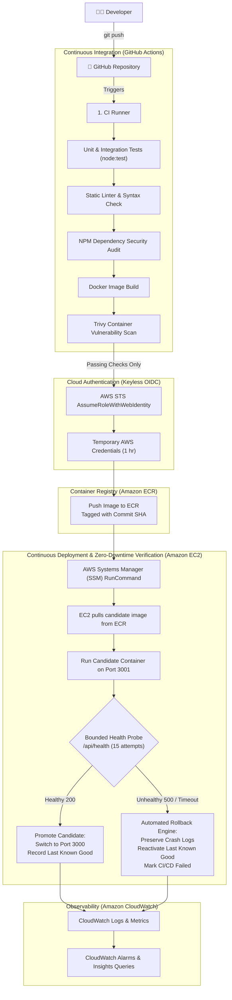
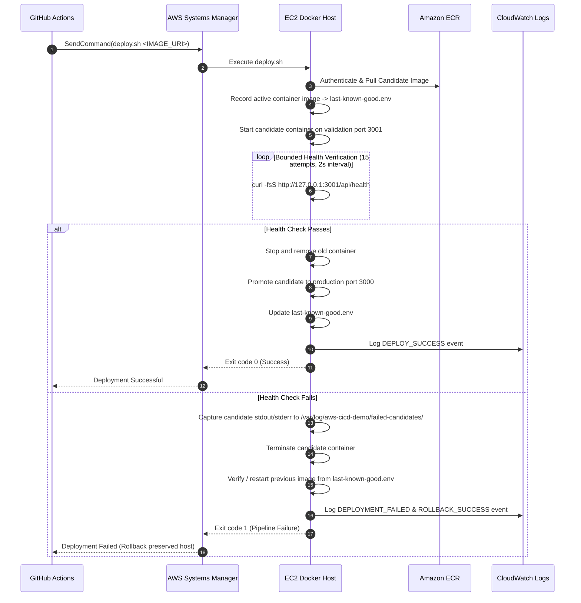
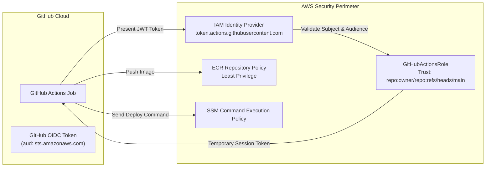

# System Architecture & Technical Design

This document details the end-to-end architecture of the **Automated CI/CD Pipeline with AWS Deployment, Docker Containerization, Automated Rollback, and CloudWatch Monitoring**.

---

## 1. High-Level Pipeline Flow

---

## 2. Zero-Downtime Deployment Sequence

To avoid single-instance downtime during container updates, a **Candidate Validation Port** strategy is implemented:

---

## 3. Security Boundary & Identity Federation

---

## 4. Key Architectural Trade-Offs

| Decision | Alternative Considered | Selected Approach | Rationale |
| :--- | :--- | :--- | :--- |
| **Authentication** | Long-lived IAM Access Keys stored in GitHub Secrets | AWS IAM OpenID Connect (OIDC) Federation | Eliminates credential leak risks, no secret rotation needed, credentials expire within 1 hour. |
| **Compute Deployment** | Direct SSH (port 22) from GitHub Actions | AWS Systems Manager (SSM) RunCommand | Zero open inbound ports needed for remote deployment; audited centrally via AWS CloudTrail; no private SSH keys stored in CI. |
| **Container Strategy** | Blue/Green with Application Load Balancer (ALB) | Dual-port candidate verification on single EC2 instance | Extremely cost-conscious for student/entry-level portfolio ($0 under Free Tier vs $16+/mo for an AWS ALB), while achieving automated candidate health testing and instant rollback. |
| **Rollback State Storage** | Remote database / S3 | Local deterministic state file (`/opt/aws-cicd-demo/last-known-good.env`) | Zero network dependency during emergency recovery; fast and reliable rollback even during cloud network partitions. |
