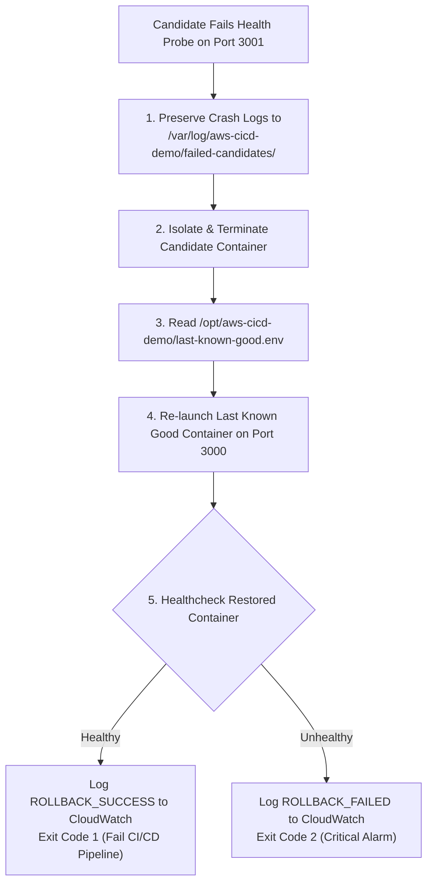

# Automated Rollback & Disaster Recovery Guide

This document explains the recovery mechanisms, automated rollback logic, and disaster recovery drills implemented in `aws-cicd-demo`.

---

## 1. Automated Rollback Trigger Conditions

An automated rollback is triggered immediately when a new candidate release fails its health verification:

1. **HTTP Status Failure**: Candidate returns HTTP 500 (or any status code other than 200).
2. **Payload Discrepancy**: Candidate returns HTTP 200, but JSON `"status"` is not `"healthy"`.
3. **Startup Crash / Port Unreachable**: Candidate container crashes on startup (e.g., missing runtime environment variable or uncaught exception).
4. **Timeout Exceeded**: Candidate fails to become responsive within 30 seconds (15 attempts * 2s).

---

## 2. Automated Rollback Sequence

When any of the above conditions occur:



### Key Safety Guarantees:
- **No False Positives in CI**: Even though the host is safely recovered and user traffic remains unimpacted, the GitHub Actions deployment job **deliberately exits with code 1 and is marked as FAILED**. This notifies the engineering team immediately that a bad release was pushed.
- **Evidence Preservation**: The candidate container's full stdout and stderr are dumped to disk before container removal.

---

## 3. How to Conduct a Rollback Drill

We have built a dedicated **Simulated Failure Mechanism** into the application to safely verify rollback without editing production code.

### Step 1: Trigger Workflow with Failure Simulation
1. Go to your GitHub repository > **Actions** tab.
2. Select **CI/CD Pipeline**.
3. Click **Run workflow**.
4. In the dropdown for `Simulate candidate health check failure`, select: `true`.
5. Click **Run workflow**.

### Step 2: Observe Pipeline Outcome
1. GitHub Actions builds and scans the container.
2. Deployment executes on the EC2 host.
3. Candidate container starts on port 3001 with `SIMULATE_FAILURE=true`.
4. Health probe receives HTTP 500:
   ```json
   {"status":"unhealthy","error":"Simulated failure active for rollback testing"}
   ```
5. `deploy.sh` catches the failure and calls `rollback.sh`.
6. Candidate logs are saved to `/var/log/aws-cicd-demo/failed-candidates/`.
7. The previous healthy container is restored on port 3000.
8. The GitHub Actions job turns **RED / FAILED** with the exact error output in the logs.
9. Visiting `http://<EC2_PUBLIC_IP>` shows that the application is still live and healthy on the previous version!

---

## 4. Manual Rollback to a Specific Release

If you need to roll back manually to an earlier historical image:

### Option A: Via AWS SSM
```bash
aws ssm send-command \
  --instance-ids "<YOUR_EC2_INSTANCE_ID>" \
  --document-name "AWS-RunShellScript" \
  --parameters 'commands=["/opt/aws-cicd-demo/rollback.sh <ACCOUNT_ID>.dkr.ecr.ap-south-1.amazonaws.com/aws-cicd-demo:<DESIRED_COMMIT_SHA>"]' \
  --region ap-south-1
```

### Option B: Via SSH or Session Manager Shell
```bash
/opt/aws-cicd-demo/rollback.sh <ACCOUNT_ID>.dkr.ecr.ap-south-1.amazonaws.com/aws-cicd-demo:<DESIRED_COMMIT_SHA>
```
