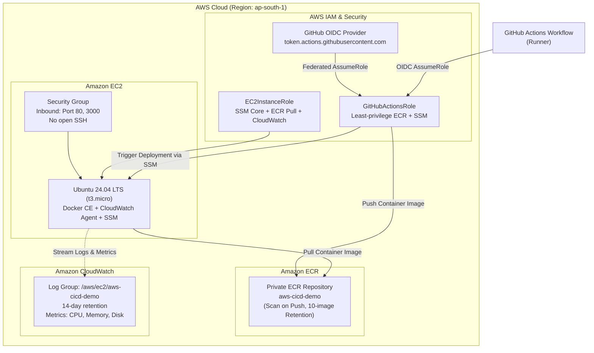

# Infrastructure as Code (IaC) - AWS CloudFormation

This directory contains the production Infrastructure-as-Code definitions for provisioning the container registry, compute host, logging infrastructure, and OIDC security federation for the `aws-cicd-demo` system.

---

## Architecture Overview



---

## Resources Provisioned

| Resource | Service | Specification / Rationale |
| :--- | :--- | :--- |
| `aws-cicd-demo` | **Amazon ECR** | Private repository, automated vulnerability scanning on push, automated lifecycle rule expiring images beyond the 10 most recent. |
| `aws-cicd-demo-host` | **Amazon EC2** | Ubuntu 24.04 LTS, `t3.micro` (AWS Free Tier eligible), encrypted 20GB gp3 root volume. |
| `aws-cicd-demo-sg` | **Security Group** | Allows HTTP (80) and Application (3000) ingress. **Port 22 SSH is not opened to the internet**; remote shell is handled securely via AWS Systems Manager Session Manager. |
| `aws-cicd-demo-ec2-role` | **AWS IAM** | Grants EC2 permissions to pull from ECR, emit CloudWatch logs and custom metrics, and communicate with SSM. |
| `aws-cicd-demo-github-oidc-role` | **AWS IAM** | Keyless OIDC trust role for GitHub Actions workflows, restricted to your specific repository branch. |
| `/aws/ec2/aws-cicd-demo` | **CloudWatch Logs** | Centralized application and deployment event log group with cost-conscious 14-day retention. |

---

## Prerequisites

1. AWS CLI v2 installed and configured.
2. An AWS IAM user/role with permissions to manage CloudFormation, EC2, IAM, ECR, and CloudWatch.
3. If this is your first time using GitHub Actions OIDC in this AWS account, create the GitHub OIDC provider once:
   ```bash
   aws iam create-open-id-connect-provider \
     --url "https://token.actions.githubusercontent.com" \
     --client-id-list "sts.amazonaws.com" \
     --thumbprint-list "6938fd4d98bab03faadb97b34396831e3780aea1" \
     --region ap-south-1
   ```

---

## Step-by-Step Deployment Commands

### 1. Validate the Template Syntax
```bash
aws cloudformation validate-template \
  --template-body file://infrastructure/cloudformation.yaml \
  --region ap-south-1
```

### 2. Deploy the Infrastructure Stack
Replace `<YOUR_GITHUB_ORG>` and `<YOUR_GITHUB_REPO>` with your GitHub organization/username and repository:
```bash
aws cloudformation deploy \
  --template-file infrastructure/cloudformation.yaml \
  --stack-name aws-cicd-pipeline-stack \
  --parameter-overrides \
      EnvironmentName=production \
      InstanceType=t3.micro \
      GitHubOrg=<YOUR_GITHUB_ORG> \
      GitHubRepo=<YOUR_GITHUB_REPO> \
  --capabilities CAPABILITY_NAMED_IAM \
  --region ap-south-1
```

### 3. Retrieve Stack Outputs
```bash
aws cloudformation describe-stacks \
  --stack-name aws-cicd-pipeline-stack \
  --region ap-south-1 \
  --query "Stacks[0].Outputs" \
  --output table
```

Key outputs to record:
- **`GitHubActionsRoleArn`**: Set this as the `AWS_ROLE_TO_ASSUME` secret in your GitHub repository.
- **`ECRRepositoryUri`**: Container registry URI (e.g., `123456789012.dkr.ecr.ap-south-1.amazonaws.com/aws-cicd-demo`).
- **`EC2InstanceId`**: EC2 Instance ID used by AWS SSM deployment tasks.
- **`ApplicationURL`**: Public URL to test in your web browser.

---

## Infrastructure Teardown & Decommissioning

To cleanly delete all cloud resources and avoid ongoing AWS charges:

```bash
# 1. Empty and delete ECR repository
aws ecr delete-repository \
  --repository-name aws-cicd-demo \
  --force \
  --region ap-south-1

# 2. Delete CloudFormation stack
aws cloudformation delete-stack \
  --stack-name aws-cicd-pipeline-stack \
  --region ap-south-1

# 3. Wait for deletion to complete
aws cloudformation wait stack-delete-complete \
  --stack-name aws-cicd-pipeline-stack \
  --region ap-south-1
```
Or run `./scripts/cleanup.sh --aws`.
